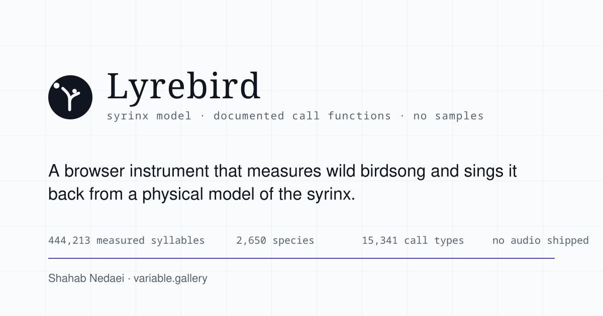
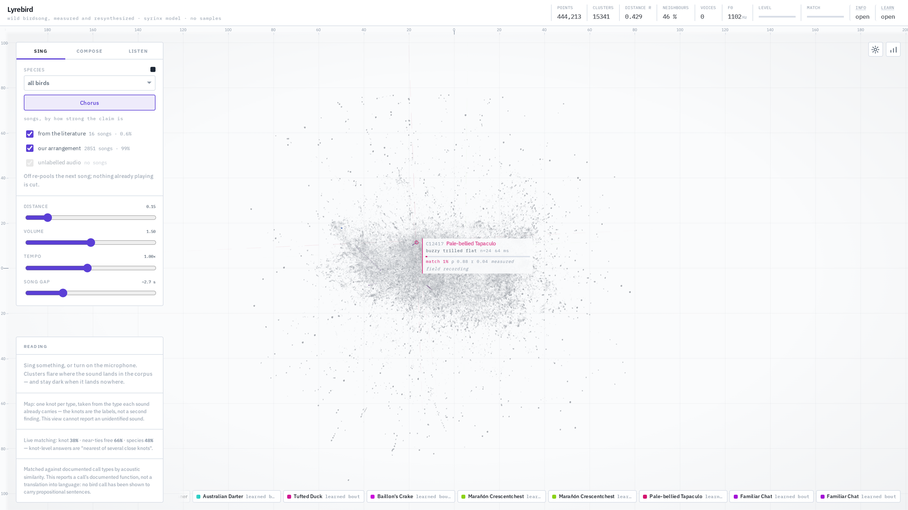
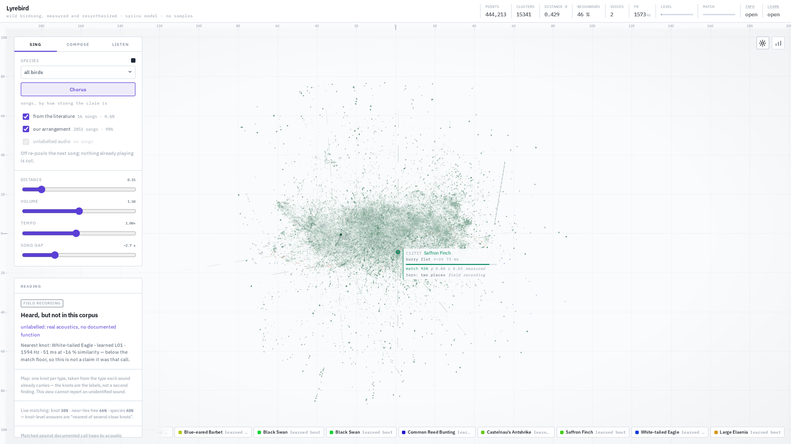
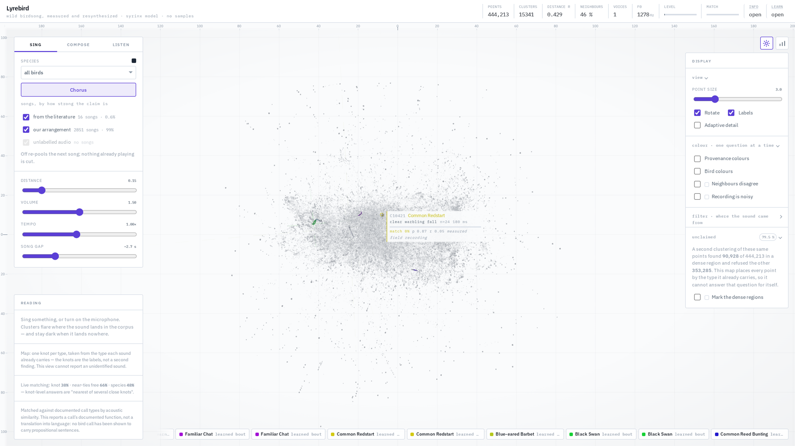
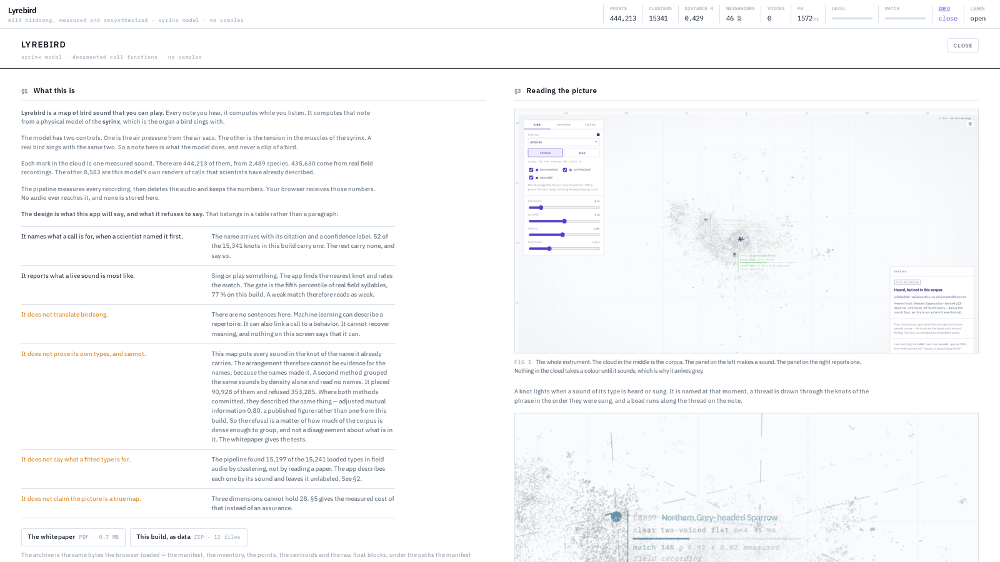
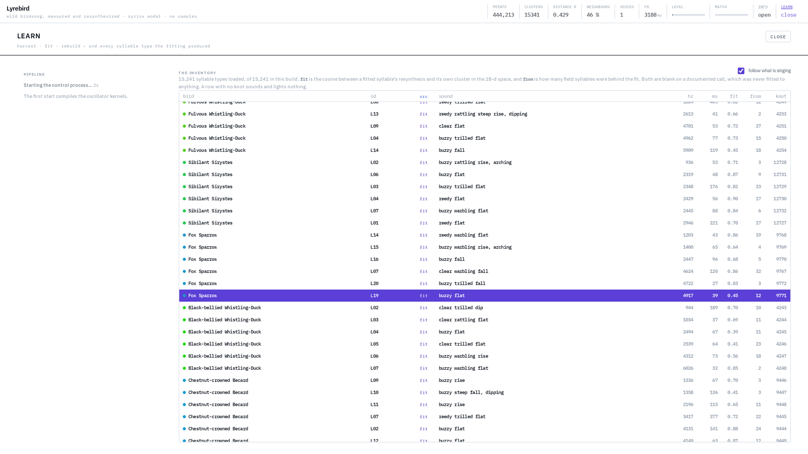

<div align="center">



### **[→ lyrebird.variable.gallery](https://lyrebird.variable.gallery)**

An art–science work by **[Shahab Nedaei](https://shahabnedaei.variable.gallery/)** · [variable.gallery](https://variable.gallery/)
[The paper](app/static/lyrebird-whitepaper.pdf) · [The research notes](docs/) · [What the licence covers](NOTICE.md)

</div>

---



Record real birds, match their calls against documented call functions, and sing back
synthetic birdsong from a physical model of the syrinx — inside an audio-reactive 3D
embedding galaxy that flares where the sound lands in the corpus.

**Nothing is sampled.** Every note is integrated from the Mindlin–Laje syrinx oscillator in
an AudioWorklet, driven by the two parameters real birds control: air-sac pressure and
syringeal tension. The pipeline measures each recording, deletes the audio and keeps the
numbers; your browser receives the numbers.

**It runs entirely on your machine.** No server, no backend, no request after the assets
land — `adapter-static`, `ssr = false`, and about 113 MB of corpus parsed in the tab.

| | |
|---|---|
| **444,213** measured syllables | from wild recordings (xeno-canto, iNaturalist) |
| **2,489** species | in the shipped build |
| **15,341** call types | each with a fitted syrinx oscillator |
| **0 bytes** of audio shipped | every note is integrated in the browser |

### Contents

- [What it will not say](#what-it-will-not-say) — the confidence labels, and why they exist
- [Run it](#run-it) — three commands
- [Seeing it](#seeing-it) — the stage, colour, the two pages
- [The galaxy](#the-galaxy) — the camera, the tags, the chorus, the controls
- [Listening](#listening) — microphone, computer audio, and what the match meter means
- [Growing the corpus](#growing-the-corpus-from-real-recordings) — harvest, learn, critic
- [What the fitted voices actually achieve](#what-the-fitted-voices-actually-achieve) — the honest numbers
- [Deploying it](#deploying-it) · [Verifying it](#verifying-it) · [Licence](#licence)

---

## What it will not say

It does not translate birdsong into sentences, and it says so in the interface. Machine
learning today can characterise a repertoire and link calls to behaviour; it cannot
recover propositional language, and for most species no playback experiment exists to
anchor meaning at all (Rutz et al., *Science* 2023). So every phrase Lyrebird shows carries
a confidence label:

| label | meaning |
|---|---|
| **playback-verified** | function established by playback experiments on wild birds |
| **documented** | function described in the literature |
| **inferred** | plausible from context, not experimentally established |
| **field recording** | real audio of a known species, with no documented function at all |
| **invented** | our own mapping — not a claim about real birds |

Typed words are rendered through a species' own song syntax and are always labelled
*invented*, except for the handful of calls that really do have experimentally
established functions (the Japanese great tit's ABC-D compound, chickadee note
composition, Siberian jay alarm types), which are rendered as the real syllable sequence
with its citation.

---

## Run it

The galaxy, the cluster centroids and the oscillator calibration table are generated
offline, so build them first:

```bash
cd pipeline
uv sync
uv run lyrebird-pipeline build      # writes app/static/lyrebird/
```

Then the app:

```bash
cd app
npm install
npm run dev
```

Lyrebird v1 needs no backend: `adapter-static`, precomputed assets, client-side features and
client-side synthesis. Audio never leaves the browser and no model runs on a server.

### Layout of the repository

```
data/inventory.json   canonical data: 12 species, 44 syllable types, songs, grammars,
                      documented functions with citations. Read by BOTH halves.
docs/                 the research this is built on; 08-implementation.md is the contract
docs/figures/         the README's figures — regenerate with `npm run figures` in app/
pipeline/             offline Python (uv): renders a corpus, calibrates the oscillator,
                      harvests and learns from field audio, builds the galaxy
app/                  SvelteKit + TypeScript: realtime synthesis, mic analysis, 3D galaxy
```

The two halves implement the same physical model and the same feature extractor, both
specified in [`docs/08-implementation.md`](docs/08-implementation.md). That document is
normative: if the halves disagree, the galaxy lights the wrong stars.

---

## Seeing it

<table>
<tr>
<td width="50%"></td>
<td width="50%"></td>
</tr>
<tr>
<td><b>Colour says one thing at a time.</b> The provenance tint answers <i>where did this sound come from</i>. It is nearly one green here, and that is the finding: 94 % of the corpus is real field audio.</td>
<td><b>Every panel folds.</b> Point size, rotation, labels, the level-of-detail governor, four colour languages that are mutually exclusive by rule, and per-class visibility.</td>
</tr>
<tr>
<td></td>
<td></td>
</tr>
<tr>
<td><b>The Info page</b> states what the app will say and what it refuses to say, in a table rather than a paragraph, and carries the whitepaper and the loaded build as a download.</td>
<td><b>The Learn page</b> drives the pipeline from the interface and lists every fitted syllable type, following whatever is singing.</td>
</tr>
</table>

---


## The galaxy

The app opens with **no bird selected**: nothing is dimmed, the whole corpus is the
subject, and the camera fits all of it. One camera rule covers everything after that —
it frames the most specific thing you have chosen, and flies there when that changes.
Pick a bird and it fits the region that bird's clusters occupy; pin a node and it fits
that node; pick a phrase out of the history and it fits the phrase. The fit is to the
85th percentile of the reach rather than the furthest member, because a species is not a
region in the acoustic layout — two of its calls sound like some other bird's and sit
across the cloud — and fitting to the maximum would frame those two strays and show you
the whole galaxy again.

The shipped galaxy is **348,461 points in 14,003 knots**, built with `--clustering label`
over the production store's 2,423 species: one knot per syllable type for the 13,903 types
that carry a label, plus 100 k-means clusters for the 20,241 points that carry none. Type
coverage is **13,903/13,903 = 100 %**, because a cluster is what carries a name, a
function and a citation, and a type with no cluster carries none of the three.

<details>
<summary><i>Superseded measurement, kept on the record</i></summary>

This read **31,328 points in 176 clusters** — 11,328 clips rendered from the inventory plus
20,000 descriptors of real xeno-canto audio from 434 recordings across twelve species, one
cluster per syllable type over the 44 authored and 132 fitted ones. Most of the corpus
statistics quoted further down this file were measured on that build and are marked where
they appear.

</details>

Points are individual clips; clusters are call types. Selecting a bird dims the other
species and narrows the floating node labels to that repertoire, so the picture changes
with the selection instead of showing all twelve species at once regardless. Each node
carries a specimen tag — what the cluster is, how many points fell into it, how tight it
is — that opens up and shows the documented function and the live match percentage when
its cluster responds.

At most twenty-six tags are drawn at once, and they are spent in a fixed order:
whatever is responding, then whatever has a documented function, then whatever is
nearest. The budget is a **fixed pool of 28 tag elements** bound to knots by slot, so
both the DOM cost and the per-frame cost are the pool's and neither moves when the corpus
grows — the earlier layer built one tag per knot and wrote to every one of them every
frame, which at 14,003 knots would have been ~250,000 elements and ~98,000 style writes a
frame to draw at most 26 tags. Collision culling alone was never going to scale: the
exclusion boxes tile the middle of the view and you get a wall of text that happens
not to overlap. The middle term matters most now that most clusters are field audio: a
named cluster carries a function and a citation, and "unlabelled field cluster" repeated
forty times carries neither, so it should not be what crowds the named ones out.

Points respond **individually**, not as clusters. The pipeline ships an 8-dimensional
per-point projection of the descriptor space, and the browser takes a cosine against
every point each frame, so a knot lights from the inside out and you can see which
members of a call type a sound actually resembles. The reported match still uses the
28-d centroids the contract specifies; the per-point space only decides brightness.

The chorus comes in two forms. **This bird** is the selected species and its
neighbours, drawn against its own backdrop of songs. **All species** sets the selection
aside entirely — no focus, no backdrop — and every bird that starts singing adds its own
trajectory, so a dozen threads light in parallel and the whole corpus is visibly moving
rather than one diagram being redrawn.

**Distance** is one control over two things: it drives air absorption and reverb in the
audio, and the viewing scale in the picture, so a bird across the field is further away
in both. The scale is exponential over roughly a seven-fold range, and the camera's
reach was raised to match: at the far end the cloud is several times its own radius
across, and a viewer that cannot back away from it turns the control into a wall.

**Tempo** slows the birds — how long each syllable lasts, how often one starts, and the
per-point pulse that follows the sound. It stretches time and nothing else: pitch comes from
a syllable's contour and length from its `dur`, so unlike a tape slowing down, a bird
slowed here keeps its pitch and simply sings longer. Trill and vibrato rates are divided
by the same factor, or a slowed call stops sounding like itself. It no longer touches the
cloud's rotation, and it lives with Distance and Volume rather than under *Display*:
multiplying the drift by it made one control do two unrelated jobs, so slowing the birds
down to hear a call also froze the picture you were trying to read it in. *Rotate* is the
control for the rotation.

**What has been sung** runs along the bottom of the view, growing leftwards out of the
right-hand corner: the newest phrase is where your eye already is, and older ones extend
left until they clip. A chorus goes past faster than anyone can
read; clicking an entry draws that phrase's path back onto the galaxy, selects its bird,
and **flies the camera to it** — the knot it lives in is one of fourteen thousand in a
cloud you may have orbited away from, and "it is highlighted somewhere behind you" is not
a way to find anything.

The flight ends the moment you touch the controls. The *lock* on the phrase does not:
the cloud is drifting, and without it the thing you just asked to see rotates back out of
frame while you look at it. Orbiting and zooming stay yours throughout — the lock only
writes the point they happen around. Clicking empty space clears nothing, because
orbiting is a click-and-drag on that same surface; the reading card carries an explicit
**clear selection** instead.

### Rearranging

Colour can say which points are the same bird. It cannot make you *see* it, because the
points do not move — and the acoustic layout answers "what sounds like what", not "which
of these are the same bird".

**Arrange** does move them. Each grouped layout keeps every point's offset from its own
group's centre and pushes the centres apart, so a group's internal shape survives the
journey and you can follow individual points across it. Two species that overlapped
acoustically visibly tear apart; a species that was already one knot barely moves. That
contrast is the information, and it is not available from a recolour.

Trajectory threads, context paths and node labels all read the same moving centroids, so
they stay welded to their knots through the transition. Nothing about the clustering, the
matching or the descriptors changes — it is a rearrangement of where the marks are drawn,
and *Sound* is always one click away.

### Colour

Every point has a **pale resting tint** and a **saturated responding one** in the same
hue. Response is a walk between them, so identity never moves and intensity always
does — and unlike a walk from dark to darker it stays legible when forty points of one
cluster overlap. Anything responding also gets a ring of the background colour around
it; without that a lit knot fuses into a single silhouette and the per-point response,
which is the entire point of the view, disappears.

Since the arrangement says what the grouping is, colour only has to say whether to
carry it: the display control offers **Monochrome** and **Coloured**, and what a colour
*means* follows the arrangement — species hues under Sound and Bird, the three-step
claim palette under Meaning. Monochrome drops the category entirely and leaves response
to value, size and the ring, which is most of what carried it anyway.

**Meaning** gives each cluster a colour for how much meaning is claimed for it —
*referential* (names something outside the bird), *social* (says something about the
singer), *structural* (a song element carrying syntax and no referential meaning). The
pipeline sorts each documented function into a behavioural class using a keyword table it
writes into `manifest.json`, so the grouping can be audited.

<details>
<summary><b>What colour can and cannot carry here</b> — the arithmetic behind "colour is orienting, not identifying"</summary>

Twelve species hues cannot be told apart by colour alone, and that is arithmetic rather
than a failure of taste: at usable chroma, clearing the ΔE 15 normal-vision floor needs
about 52° between hues, so a wheel holds roughly seven, and colour-vision deficiency cuts
that to about three. Separating on lightness as well as hue takes the worst species pair
from ΔE 5 to 12.9, which is better but still short. So colour in the Bird view is
*orienting*: every cluster carries a label naming its species, selecting a bird dims the
others, and the reading panel says which bird it heard. Turn the colour off entirely and
nothing becomes unreadable. The three-step Meaning palette is the one held to the full
gate — worst pair ΔE 9.2 deutan, 24.0 normal — because there it is doing real categorical
work.

</details>

### Nothing matching has to look like nothing matching

Softmax is a relative measure — its outputs sum to 1, so whatever you feed it, some
cluster always wins. Fed room tone or a fan, the matcher used to pin 100 % on an
arbitrary call and hold it there indefinitely, which is what made the galaxy hang on one
node while nothing was playing.

The activation is scaled by an absolute measure of how well the best centroid actually
matches, and the thresholds come from the corpus rather than from taste. So there are two
tests now, and both have to pass. The cosine ramps from **0.62 to 0.86**, which lets in
about nine real syllables in ten. On top of it a **tonality gate** zeroes anything whose
spectral flatness runs from 0.40 to 0.55 — a margin that touches under 1 % of genuine
birdsong and kills both noise probes outright.

<details>
<summary><b>Why the cosine alone is not enough</b> — the measurements, and the one probe that is deliberately not rejected</summary>

Re-measured by `lyrebird-pipeline thresholds` against the assets of the time — **the
176-cluster build, not the shipped production one**; the thresholds have not been
re-measured since, and the numbers below should be read as that build's:

| input | best-centroid cosine | spectral flatness |
|---|---|---|
| real harvested syllables (n = 2000) | p10 0.654 · p50 0.801 · max 0.992 | p99 0.345 |
| a 1 kHz hum | 0.917 | 0.000 |
| white noise | **0.996** | 0.848 |
| room tone at −60 dBFS | **0.996** | 0.848 |

**The cosine alone no longer separates birdsong from noise, and pretending otherwise
would be the easiest lie in this project.** Those two bold numbers are above the *median*
real syllable. The reason is not a bad threshold: against a corpus that is two thirds
field audio, some clusters are bins of wind and rain, and averaging 59 noise-leaning
syllables produces a centroid more noise-like than any of its members — they score
p99 0.941 individually and 0.996 pooled. Dropping the worst cluster only promotes the
next one, and the top three (1064 points, 3.4 % of the corpus) shade into a genuine
continuum: a wren's trill really is broadband.

The hum is deliberately *not* rejected. A 1 kHz sine has flatness 0.000 and scores 0.917
against a tawny owl whose learned call sits at 907 Hz; those two sounds really are close
in this feature space, and reporting a strong match is the honest answer rather than a
bug. `npm run verify:features` asserts all of this on every build, so the gate cannot
quietly stop holding.

</details>

The **match** meter in the header shows the resulting number, so a stuck reading is
visible rather than mysterious. Below about 25 % the reading panel reports nothing. If
your input device is a system-audio loopback rather than a microphone, Lyrebird will hear
its own output — the match meter is the way to tell.

### Listening

The Listen tab chooses between a **microphone** (with a device picker) and **computer
audio** via display capture — tick "share audio" in the browser's dialog or no sound
arrives. Echo cancellation, noise suppression and gain control are all switched off:
they are tuned for speech and they gate exactly the quiet broadband texture a distant
bird is made of.

A recording can be sent straight into the learning store with **Learn from this**. It
goes through the pipeline's own segmenter — the same function that processes downloaded
audio — rather than a second implementation in the browser, so a bird recorded at your
desk and one fetched from xeno-canto are analysed by identical code.

---

## Growing the corpus from real recordings

The shipped galaxy is rendered from the hand-authored inventory. Two further commands
grow it from field audio without ever holding more than one recording at a time:

```bash
cp .env.example .env && $EDITOR .env                      # your xeno-canto v3 key
uv run lyrebird-pipeline harvest --per-species 40         # stream in, keep a bounded sample
uv run lyrebird-pipeline learn                            # fit syllables + syntax, verify them
uv run lyrebird-pipeline build --inventory ../data/learned-inventory.json \
                            --harvest-store out/harvest \
                            --clustering label
```

`--clustering label` is what the shipped production build uses: a point that already
carries a type goes to its own type's knot, and k-means fits only the unlabelled
remainder. It is a flag rather than the default because it **failed its own
pre-registered gate** on a corpus small enough that the cluster cap does not bind
(+2.5 points of type retrieval against a +10 bar) and passes by +14.2 where the cap
binds, which is production's condition. Add `--keep-audio DIR` to `harvest` if you want
the audio kept where its licence permits.

`harvest` fetches, decodes, analyses and **deletes** each recording before the next one
starts, keeping a species-stratified reservoir of 28-d descriptors capped at a size you
choose. It also tracks statistics over every descriptor it discards, so it can tell you
how far the sample it kept has drifted from the stream it came from.

Deleting is the default, not an invariant. Since **2026-08-01** `harvest --keep-audio DIR`
may keep a recording on the machine where its licence permits, gated per recording:
**NoDerivatives is refused** and **an unrecorded licence is refused**, because absence of
a licence is not permission. Nothing audio ever ships to the browser. See
[`NOTICE.md`](NOTICE.md) §3.4 for the policy and its measurements.

`learn` fits syllable parameters to the segmented audio, then renders each fitted
syllable through the same syrinx oscillator the app uses and records how close it lands
— descriptor cosine and F0 error, written next to every learned syllable. Syllable order
within a recording gives a first-order grammar, which is what lets Lyrebird compose phrases
no bird sang in a syntax measured from birds that did. Those phrases are labelled
*invented*; their syllables are labelled *field recording*.

`learn` writes the fitted types **next to** the documented ones rather than instead of
them: fitted ids start with `L`, carry `unlabelled` confidence and no function, and
every playback-verified call keeps its citation. `--learned-only` writes the fitted
repertoire on its own.

Still nothing is sampled. The recordings are the *measurement*, not the material: what
survives one is a few dozen numbers per syllable — duration, level, attack, an F0
contour, modulation depths, a timbre class — and the note you hear afterwards is
integrated from the oscillator, as every note in Lyrebird is. That is the route the
research names for "record a real bird, then re-sing it synthetically"
([`docs/04-synthetic-bird-voices.md`](docs/04-synthetic-bird-voices.md) §4.2, Boari
et al. 2015), and the resynthesis cosine printed next to each fitted syllable is how
you know whether the model really caught the bird.

### Learning what a syllable is

Two further commands learn *what a syllable is* from the ones already harvested, rather
than deciding it by hand. They need `uv sync --extra critic` (PyTorch; the wheels are CUDA
by default and CPU works too), and nothing they produce ever reaches the browser:

```bash
uv run lyrebird-pipeline critic train --store out/harvest-gan \
                                   --inventory ../data/learned-inventory.json
uv run lyrebird-pipeline learn --store out/harvest-gan --critic out/critic.pt --embed-typing
uv run lyrebird-pipeline placement --store out/harvest-gan --inventory <the fit>
```

`critic train` trains one small CNN on log-mel patches of the harvested syllables, with
three heads: real-versus-resynthesis, which bird it is, and whether two augmented views of
one syllable land together. Its 32-d penultimate layer is a learned answer to "what makes
two syllables the same type", replacing the seven hand-weighted numbers that decided it
before. `--embed-typing` clusters in that embedding. `placement` scores a fitted inventory
on whether each resynthesis lands nearest its own *species*, which is the number the
resynthesis cosine cannot tell you.

Measured twice, on a 9 041-syllable harvest of 25 species and a 39 993-syllable one of 13,
learned typing moves species placement **26.6 % → 32.9 %** and **38.4 % → 51.7 %**
respectively, both with the resynthesis cosine held and median F0 error improving. The same
network's realism logit was also tried *as the objective the fit optimises*, which is what
[`docs/09-learned-objective-plan.md`](docs/09-learned-objective-plan.md) set out to do, and it
made every number worse at every weight on both stores — so `--critic-weight` defaults to 0.
§9.7 and §9.8 of that document have the ablations, and why the negative result is the more
useful half.

The critic also answers "**is this a syllable I have not heard?**" — a distance in the
embedding, thresholded so the false-positive rate is chosen rather than discovered
(measured: 4.7 % against a requested 5 %). A syllable it flags is still labelled
`unlabelled`: knowing a sound is new is not knowing what it means.

---

## What the fitted voices actually achieve

Measured on the 434-recording harvest of 2026-07 — 31,653 segmented syllables, 12 fitted
types per species. **These numbers have not been re-taken on the production store**
(10,184 recordings, 13,903 types), and the closest current figure is the production `learn`
run's median resynthesis cosine of **0.648**:

| measure | before inversion | after inversion |
|---|---|---|
| F0 error of the resynthesis against its own contour | — | **median 0.80 %** |
| resynthesis cosine to the syllables it was fitted to | median 0.31 | **median 0.547** |
| cosine to the *nearest rival* type | — | **median 0.533** |
| resynthesis nearest its *own* type rather than another | 40 of 132 | **67 of 132** |

The gesture search (nine contour knots, three passes over ten parameter axes) nearly
doubles the resynthesis cosine and takes own-type nearest from 30 % to 51 %. It does not
rescue the result, and the fourth row is why: **0.547 against its own type, 0.533
against the nearest rival.** The fit is barely better at resembling the call it was
fitted to than it is at resembling a different call by the same bird.

Read against the frame those cosines live in — two real syllables of one type score
about 0.78, two of *different* types about 0.49 — the fitted voices sit at 0.547, which
is nearer the different-type baseline than the same-type one. That is a clear result and
not a flattering one: **the oscillator reaches the pitch and does not reach the timbre.**
The F0 error is 0.80 %, so the contour is essentially exact; everything the descriptor
still objects to is spectral. A field recording carries wind, distance, a second bird and
a room; a two-parameter oscillator carries none of that, and 26 MFCC dimensions notice.

How much they notice is worth stating as its own number, because it turns out to be the
largest single effect in the whole system. Of the 176 clusters in the galaxy of the time,
**82 hold nothing but field audio, 86 hold nothing but synthetic renders, and exactly one
is a mixture.** A real call and Lyrebird's resynthesis of that same call do not merely
score poorly against each other — they are never even grouped together. The dominant axis
of this feature space is *was this recorded or synthesised*, not *what does it sound like*,
and that is why one sound can light two knots on opposite sides of the galaxy: the note
being sung is the synthetic cluster, and the field cluster of the same call is somewhere
else. See the pipeline README, "The loudest thing in this space is the microphone", for
what it costs and what would fix it.

<details>
<summary><b>What was done about it</b> — W5, and what the fix costs</summary>

**That measurement is what W5 acted on, and W5 is now the default** (docs/22 §22.6,
docs/23 §23.5). A type that has real member observations no longer renders a synthetic
copy of itself — it already exists in the map as the field syllables assigned to it — so
the recorded-vs-synthesised axis has far less to sort. `--member-anchor` buys the rendered
voice back for anyone who wants it; the old `--no-member-anchor` is gone. On the field
points every arm holds, this is worth **+0.02 points of retrieval, i.e. nothing**; what it
buys is the map, at half the knots and a quarter fewer points, and the owner took it on
that basis. The cost is stated rather than hidden: **the rendered voice loses its own
place on the map**, and 3D distance faithfulness fell 0.903 → 0.747 on debug-100 because
removing the rendered copies removed structure the projection found easy. Nothing about
knots or matching uses those 3D positions.

</details>

<details>
<summary><b>Why the numbers say this at all</b> — the previous version of this check could not fail</summary>

It compared a fitted syllable against the *recording-level* descriptor — a five-second
window average over everything that recording contained, identical for every type of a
species — in the corpus statistics of a synthetic build. In that frame every field
syllable scores 0.99 against every other, so the check could not fail. It now compares
against the syllable's own audio, in a frame centred on the harvested population, where
0.78 and 0.49 are measurably different numbers.

</details>

### Why not just play the recordings back?

It would sound better — it would sound perfect, because it would be the bird. Two things
stop it, and only one of them is philosophy.

The first is the licence, and it is measured rather than assumed. On the production store
of **10 184 recordings, 90.3 % carry a licence under which the audio may be kept, and all
10 184 carry a recordist** — so attribution is available for every file. The 9.7 % that
fail are NoDerivatives clips plus recordings whose licence the archive never recorded. ND
audio cannot legally be pitch-shifted or time-stretched at all, because that makes a
derivative. A *shipped* sample bank would additionally mean carrying per-clip attribution
into the interface, and the majority of the corpus is CC BY-NC-SA, which is
non-commercial in its own right.

The second is the claim. "Nothing is sampled; every note is integrated from the syrinx
model" is what makes the galaxy's response mean anything — the app is showing you what a
physical model of a bird does, and a played-back sample is a recording of a bird rather
than a claim about one.

There is a version that costs neither, and since **2026-08-01 it exists**: a **local**
sample bank, never shipped. `harvest --keep-audio DIR` keeps each analysed recording where
its licence permits (`harvest.audio_may_be_cached`: no NoDerivatives, no unrecorded
licence). Nothing is redistributed, so the licence question does not arise, and it is the
strongest possible demonstration of the science — you can hear exactly how far 0.547
cosine is from the real thing. The owner declined the other half on the same day:
**no audio ships to the browser**, so the local bank is not wired into the app.

Every harvested recording's recordist and licence is written to `CREDITS.md` in the
store. xeno-canto recordings are individually licensed and CC-BY-NC-SA is common.
See [`NOTICE.md`](NOTICE.md) §3 for what that obliges, and
[`pipeline/README.md`](pipeline/README.md) for the mechanics.

<details>
<summary><i>Superseded measurement, kept on the record</i></summary>

An earlier draft of this section counted the 435-recording harvest of 2026-07: 344 CC
BY-NC-SA, 68 CC BY-NC-**ND**, 18 CC BY-NC, three CC BY-SA, one CC0 — so four could be
redistributed commercially. That corpus is 24x smaller than the production store and the
conclusion it was used for ("accepting non-commercial for the whole app") is no longer
hypothetical: **the project is non-commercial**, see [`LICENSE`](LICENSE) and
[`NOTICE.md`](NOTICE.md).

</details>

---

## Driving the pipeline from the interface


`npm run dev` starts the control process for you — a Vite plugin
([`app/vite-plugin-pipeline.ts`](app/vite-plugin-pipeline.ts)) runs
`uv run lyrebird-pipeline serve` in the background, hands its job log to Vite's output and
kills it when the dev server stops. If something already answers on the port it is left
alone, and if `uv` is missing dev keeps serving and the Learn tab says how to start the
process yourself. `LYREBIRD_PIPELINE=0` turns the autostart off; `LYREBIRD_PIPELINE_PORT`
moves it.

The app's **Learn** page picks that up and gives you the same three operations with the
store's figures in front of you and the job's log streaming back. It binds to
`127.0.0.1` only and the address is not configurable — every endpoint runs pipeline
code, so exposing it on a network would be handing out remote execution. The running app
still needs no backend: this is a developer-facing process for driving the offline stage,
and the built site never talks to it.

**A build re-places every point at once**, and there is no way around that: clustering,
the projection and the per-point feature space are all computed over the whole corpus, so
a syllable learned a minute ago has no position until the build that places every other
point again. What the app does do is remove the step after it. Each build stamps
`manifest.json` with `builtAt`; the Learn page compares that stamp with the one the
running session loaded, and when they differ it re-fetches the assets under that stamp
and swaps the galaxy, the inventory and the voices in place. New nodes, new birds and
new syntax appear without a page reload.

<details>
<summary><b>When the Learn page says the pipeline is not running and you know it is</b></summary>

The page shows its "start `lyrebird-pipeline serve`" panel whenever a status request fails,
and "failed" covers two different things. Both have been hit for real:

- **Something holds the port but never answers.** A `serve` started in the background by an
  editor session can be left *suspended* (process state `T`) when that session goes away. It
  keeps the listening socket, so the kernel still completes the TCP handshake and the status
  request connects and then waits forever — the page reports the pipeline as absent while a new
  `serve` fails with "address already in use". `serve` now diagnoses this instead of raising:
  it names the holding pid and its state, and a stopped process needs
  `kill -CONT <pid> && kill <pid>`, because it cannot act on SIGTERM while suspended. Starting
  it with `setsid` keeps a dying parent session from suspending it in the first place.
- **The status call was too slow to count as an answer.** It used to rebuild the whole harvest
  store per request — a 26 MB JSON parse, 1.3 s on a 40 000-syllable store — which was over
  the plugin's probe timeout, so on a large store a *healthy* server was never detected and
  the plugin kept trying to spawn a second one. Status now reads the counts it needs from
  `state.json` and skips the syllables (0.12 s), and the probe timeout matches the client's.

The quick check either way — if this prints nothing, nothing is listening; if it prints a pid
but the `curl` hangs or times out, it is the first case:

```bash
ss -tlnp | grep 8781
curl -sS -m 5 http://127.0.0.1:8781/api/status | head -c 200
```

</details>

---

## Deploying it

**Fully client-side, by commitment rather than by default.** `app/src/routes/+layout.ts` sets
`ssr = false` and `prerender = true`, and the adapter is `@sveltejs/adapter-static`: the built
`app/build/` is a directory of files any static server can hand out. Every measurement, the
nearest-knot matching, the grammar walk and all synthesis run on the reader's machine. There is
no server-side computation anywhere, and no request leaves the browser after the assets land.

Verified, not assumed: `npm run build` then serving `app/build/` with a plain file server boots
the app, loads all 444 213 points, and reports no 4xx and no console errors.

### Railway (railpack)

Two files in `app/` configure it, and two settings go in the Railway service:

| file | what it does |
|---|---|
| `app/railpack.json` | pins Node 22, `npm ci`, `npm run build` |
| `app/Caddyfile` | how the built site is served — cache headers, and a real 404 rather than an SPA rewrite |

In the Railway service:

- **Root Directory** → `app` (the repository root is the pipeline; the deployable is the app)
- **Variable** `RAILPACK_SPA_OUTPUT_DIR` → `build` (railpack's Node provider detects Vite and
  serves the static output through Caddy, but defaults to `dist`; SvelteKit's static adapter
  writes `build`)

`package.json` deliberately has no `start` script. Railpack's start-command priority is
`start` → `main` → `index.js`, and only when all three are absent does it serve the build as
static files through Caddy — which is what this app wants, because there is nothing to start.

The corpus is about 118 MB built, most of it `app/static/lyrebird/`. It is committed, so the
deploy needs no pipeline run.

### Anywhere else

`app/build/` on any static host — Netlify, Cloudflare Pages, GitHub Pages, S3, nginx. The only
requirements are that `404.html` is served for unknown paths and that `/lyrebird/*` is not cached
by filename for long (the app appends the build stamp as a query string, so a short max-age is
enough). `app/Caddyfile` states both rules if you need a reference.

---

## Verifying it

Two checks run the browser's own DSP outside the browser, by loading the AudioWorklet
under stubbed worklet globals:

```bash
cd app
npm run verify:synth      # renders all 44 syllables, checks measured F0 vs the contour
npm run verify:features   # renders each syllable, then asks which galaxy cluster it lands in
npm run verify:layout     # the knot-spacing grid against the brute-force loop it replaced
npm run demo:wav          # writes listenable wavs to app/out/wav
```

A further set checks the things a type-checker cannot see. `verify:glsl` exists because a
backtick in a GLSL comment closes the JavaScript template literal the shader lives in, and the
resulting error points at the shader body rather than at the prose that broke it — twice in one
session. `verify:seo` reconciles every corpus figure quoted in the JSON-LD, the meta
description, the `<noscript>` block and `static/llms.txt` against the shipped manifest, because
with `ssr = false` those four surfaces are the only thing a crawler reads and nothing else in
the app would notice them going stale.

```bash
npm run verify:glsl      # no backticks inside the shader template literals
npm run verify:seo       # the SEO figures against manifest.json
npm run verify:trust     # both doubt ramps, end to end
npm run verify:unheard   # the density verdict, and which set the swap promotes
```

Three need a dev server, because only a running browser can answer them:

```bash
npm run probe:stage      # shaders, computed styles, the two pages, at 1600x1000
npm run probe:mobile     # the phone layout at three viewports: overflow, drawers, touch, rings
npm run figures          # retakes every figure in this README
```

`verify:features` is the one that matters most: it crosses the language boundary. A high
hit rate means the two ODE implementations, the two MFCC implementations and the
standardisation statistics all agree. Drift shows up here rather than as a galaxy that
quietly lights the wrong clusters. Current, on the production assets: **37/44 = 84.1 %
exact** against a 50 % floor. It failed on the shipped debug-100 build, and that was the
corpus rather than the code — debug-100 is the deepest hundred species and holds none of
the 44 authored syllables.

`verify:layout` is the repo's first renderer test: it checks the uniform grid that
computes the median nearest-neighbour knot distance against the brute-force `k²` loop it
replaced, on six shapes at six knot counts, and agrees exactly on all 36 cases.

`uv run lyrebird-pipeline verify` checks the generated assets, including that the per-point
feature rows are unit vectors and still separate their own cluster from the rest — a
mirrored PCA sign would otherwise light the wrong points with total confidence.

<details>
<summary><b>The 25/44 that was blamed on the wrong thing</b> — a diagnosis that was wrong, and the two fixes that were not</summary>

*Superseded measurement, kept on the record: this section previously read **35/44 exact,
36/44 same species** on a 384-cluster build carrying 284 types.*

**An earlier version of this section read 25/44 and blamed the learned inventory, and that
diagnosis was wrong.** The cost was not competition between a rendered `cuck` and some
fitted `L01`; it was that `cuck` had no cluster at all. `K_CAP` clamped the cluster count
below the number of types, and the count itself only ever asked for one cluster per type —
ignoring that the 20,000 harvested points need clusters too, and take them first. So the
named types shared what was left: 128 of 308 ended up with no cluster carrying their name,
and `cuculus_canorus` lost *both* of its documented calls. Nothing reported this. Purity
scores the points that have a cluster; the projection metrics never look; and in the app
`clusterIndexFor` correctly returns -1 rather than guessing, so a cuckoo simply sang with
no node to light, no trajectory to draw and no label to show, which reads as a broken app.

Two changes fixed it, and both are measured rather than argued. The cluster count now asks
for one per named type **plus** `sqrt(n/2)` for the points that have no type, and KMeans is
seeded with each type's own centre rather than by kmeans++ — which spends its seeds on the
"recorded or synthesised" axis and lets two similar calls of one bird start life sharing a
seed. Every build now prints `type coverage` and writes it to `manifest.json` with the
offenders named, so this failure can never again be silent. On the corpus of the time
coverage was **282/284**, cluster purity went **41.3 % → 59.7 %**, and cross-species
confusions halved.

The cap itself is gone. `K_CAP` was an app-side WebGL limit wearing a pipeline constant's
name — three `uniform float[clusterCount]` arrays in the vertex shader — and moving those
channels to a `DataTexture` raised it **1 024 → 8 192**. Then `build --clustering label`
made it moot for coverage: a point that already carries a type goes to its own type's
knot, and k-means fits only the unlabelled remainder. **The shipped production build is
348 461 points in 14 003 knots at 100 % type coverage** (13 903/13 903). Cluster purity
reads 94.5 % there and the manifest says in as many words that this is *not* a
measurement — a type is a cluster under label assignment, so purity is 1.0 by
construction on the labelled ones.

</details>

---

## Credits

The science behind each design decision is cited inline in `docs/`, and every call
function in `data/inventory.json` carries its reference. The syrinx model is Mindlin and
Laje's; the compositional-syntax result is Suzuki, Wheatcroft and Griesser (2016); the
pure-tone-by-resonance-filtering result that makes the tracking formant mandatory rather
than cosmetic is Beckers, Suthers and ten Cate (2003).

## Licence

**This project is non-commercial.**

Lyrebird's own code and prose are **CC BY-NC-SA 4.0** — see [`LICENSE`](LICENSE) for the
grant and the full legal code.

[`NOTICE.md`](NOTICE.md) is the part worth reading before you reuse anything, because the
licence covers less than the repository contains. It separates three things:

1. **our own work** — the pipeline, the app, the docs, the hand-authored inventory;
2. **third-party dependencies and models**, which keep their own licences. Mostly
   MIT/BSD/Apache-2.0; one optional research dependency is GPL-3.0-or-later
   (`harmonypy`) and one model compared against is itself CC BY-NC-SA (BirdNET);
3. **the harvested recordings, which are not ours to relicense.** Every field recording
   carries a per-recording Creative Commons licence granted by its own recordist through
   xeno-canto or iNaturalist. Nothing in `LICENSE` reaches any of it, and each
   recording's licence and recordist must travel with it and with anything derived from
   it. `CREDITS.md` in the harvest store is the attribution record.

For most of the corpus, non-commercial is not only our preference — it is what the
recordists chose.
